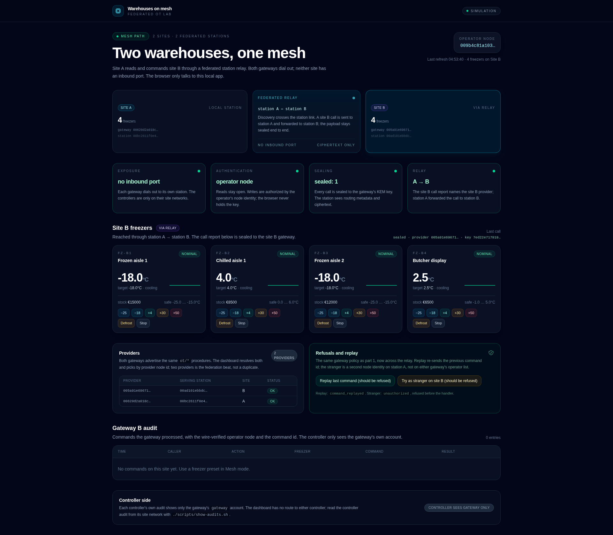

# warehouses-on-mesh

Part 2 of the macula-demos OT series: the same cold-chain company opens a second warehouse,
and the mesh is what connects them — two sites, two gateways, two federated stations, and no
inbound port anywhere.

**Status: built.** All six acceptance gates pass in the local lab. The Phase 0 relay spike is
recorded in [docs/PHASE0_RELAY_SPIKE.md](docs/PHASE0_RELAY_SPIKE.md); the honest claim-by-claim
boundaries are in [docs/WHAT_THIS_PROVES.md](docs/WHAT_THIS_PROVES.md).



## The one claim

A person at site A can read and command the freezers at site B through the mesh — across a
federated station relay — while:

- neither site has an inbound path (every box dials out),
- the calls are sealed end to end (the station relays ciphertext),
- the commands are authorized per caller, refused for strangers, and refused on replay.

Part 1 ([freezers-on-mesh](https://github.com/macula-demos/freezers-on-mesh)) proved the
single-site version. This repo proves the part the series name implies: **the mesh itself** —
two federated stations, station-to-station forwarding, and multi-provider capability resolution.

## Story

Acme Cold Storage runs the part 1 retrofit at warehouse A, then opens warehouse B with the same
controller and the same gateway. The quality manager at A needs to see and command B's freezers
without any port forward at B. Both gateways dial out to their own station; the stations are
linked with `outbound_peers`; the dashboard resolves both providers and picks by site.

## Topology

```text
site A                                   relay                                   site B
┌─────────────────────────┐      ┌──────────────────────┐      ┌─────────────────────────┐
│ dashboard  :4000        │      │       station A      │      │       station B         │
│ (browser talks here)    │      │   172.28.0.10        │      │   172.28.0.11           │
│                         │      │                      │      │                         │
│ gateway A ─── outbound ─┼─────►│  ▲     outbound      │      │  ▲     outbound         │
│ (mcl-om, no TCP listener)│      │  │     peers        │      │  │                      │
│                         │      │  └─────────┬─────────┘      │  └─────────┬────────────┘
│ controller A ◄── HTTP ──┘      │            └────────────────┼────────────┘            │
│ (FZ-A1..A4, site_a_net) │      │  station A ⟷ station B      │  gateway B ─── HTTP ──► │
└─────────────────────────┘      │  pinned, outbound only      │  controller B          │
                                 └──────────────────────┘      │  (FZ-B1..B4, site_b_net)│
                                                               └─────────────────────────┘
```

The dashboard dials station A only. A site B call is sent to station A with gateway B as its
target; station A forwards it over the station-to-station link, station B forwards it to
gateway B. The caller never dials station B. The relay sees routing metadata and the sealed
payload; the gateway alone holds the KEM key.

| Path | What crosses it |
|---|---|
| Browser → dashboard `:4000` | The local Phoenix app; the only published host port |
| Dashboard → station A | Outbound QUIC from the laptop's mesh client |
| Gateway A → station A | Outbound QUIC; gateway A has no inbound TCP listener |
| Station A ⟷ station B | Outbound QUIC, pinned `expected_node_id` on both sides |
| Gateway A → controller A | HTTP on `site_a_net`, gateway's own account |
| Gateway B → controller B | HTTP on `site_b_net`, gateway's own account |
| Dashboard → site B freezer | CALL to station A, forwarded A → B; sealed to gateway B |

## What runs today

- **Two mock controllers** — the part 1 simulator, parameterized by `SITE_ID=A`/`B`, four
  freezers each (`FZ-A1..A4`, `FZ-B1..B4`), HTTP/REST on each site's internal network.
- **Two OT gateways** — the part 1 `mcl-om` gateway, unchanged: real `ot/*` capabilities, open
  reads, operator-node write policy, command guard, gateway audit, and sealing.
- **Two federated stations** — `macula-station:0.13.3`, linked with pinned `outbound_peers`.
  `mesh-demo.sh` boots them as islands, reads their node ids, and recreates them with the pins.
- **One realm fixture** — the lab stand-in for `macula-realm`, now linked to both stations and
  advertising its boot-claim procedure on each. It writes `realm.json`, `realm-a.json`, and
  `realm-b.json` so each gateway pins its own station.
- **One Phoenix dashboard** — at site A. It removes the dead legacy path, resolves both
  gateways' `ot/*` advertisements, shows both providers, and calls the chosen provider through
  station A. A background refresh keeps a slow DHT lookup off the LiveView's mailbox.

## Quick start

```bash
./scripts/mesh-demo.sh
```

The first run pulls the station image, builds both Elixir controllers, both gateways, the
fixture, and the dashboard, and waits for the two stations to federate, both gateways to claim,
and the UI to settle. Then open <http://localhost:4000>.

The dashboard opens on **Site A**. Click **Site B · via relay** to read site B; use a freezer
preset to write it; use the replay and stranger buttons to see the refusals.

Reset the simulators at both sites:

```bash
./scripts/reset.sh
```

## The demo in five beats

1. **Topology** — two site cards, the federated relay card, and a provider table with **2
   providers**, both advertising the same `ot/list_freezers`. Everything dials out.
2. **Cross-site read** — switch to site B; `FZ-B1..B4` arrive; the last-call line says
   `sealed · provider <site B> · key …`.
3. **Cross-site write** — set `FZ-B1` to +50°C; the flash says **Gateway accepted … (sealed)**.
   The site B gateway audit names the operator node; the controller audit shows only `gateway`.
4. **Refusals** — replay the command id → `command_replayed`; try a stranger node → `unauthorized`
   before the handler.
5. **Posture** — no inbound port at either site; the relay carried ciphertext; the gateway alone
   holds the key.

The full run sheet, with captions and timings, is [docs/DEMO_SCRIPT.md](docs/DEMO_SCRIPT.md).

## Evidence scripts

These are the gates, not just demos:

```bash
./scripts/local-path-probe.sh   # site A local path and site B local path, each sealed=1
./scripts/capture-relay.sh      # site B read through station A; no plaintext in pcap or logs
./scripts/clear-call-probe.sh   # a clear call to the read capability is refused sealed_required
./scripts/phase4-gate.sh        # write ok sealed, replay refused, stranger refused, audits gateway
./scripts/posture-check.sh      # only :4000 published; no non-loopback gateway/controller listener
./scripts/show-audits.sh        # each controller's own audit, read from its site network
```

The Phase 0 spike is reproducible separately with:

```bash
./scripts/phase0-spike.sh
```

## What the mesh path proves

- The two stations are real Macula stations, linked by `outbound_peers` and pinned node ids.
  Station A's `forward_rtt` telemetry records the site B calls it forwards.
- Both gateways advertise the same `ot/*` procedure names. The dashboard resolves both, shows
  two providers, and picks by provider node id. The duplicate is the federation evidence.
- The site B read and write are sent to station A, forwarded to station B, and answer with the
  site B provider in the call report. The caller's link list does not contain station B.
- The call report says `sealed: 1`; a clear call to the same capability is refused
  `sealed_required`. `capture-relay.sh` sends a marked call through the relay and finds neither
  the marker nor the freezer payload in the pcap or either station's logs.
- The write policy is per caller. The operator's node id is the only node on either gateway's
  write allowlist; a second identity on station A is refused `unauthorized` before the handler.
- Each write carries a random command id and timestamp; a replay is `command_replayed` and a
  stale command is `command_expired`.
- Both gateways dial out. `posture-check.sh` finds no non-loopback TCP listener on either
  gateway and no host listener except the dashboard's `4000`; the controllers are attached only
  to their site networks.

## What is still missing

- A public two-station fleet across hosts (this lab runs both stations as containers on one
  Docker network) and a real `macula-realm` membership instead of the lab fixture.
- A durable command/dedupe store and a signed command log. The guard is in memory with a
  two-minute TTL.
- Signed reading history an auditor can verify without Macula (part 4).
- A real OT protocol adapter — Modbus, BACnet, OPC UA, or a vendor API (part 3).
- Multi-operator approval and dynamic enrollment/revocation (part 5).
- A plain SDK cross-station direct dial. macula 18.3.0 turns an IPv4 station endpoint into a
  bracketed URL its seed parser rejects (`unusable_seed`), so the dashboard deliberately sends
  the CALL to its own station with the other site's provider as the target. That is also the
  stronger relay path.

## Repository layout

```text
apps/
  freezer_controller/   Elixir/Bandit mock controller, SITE_ID parameterizes A/B
  admin_ui/             Phoenix LiveView dashboard, two-site mesh transport
  ot_gateway/           Erlang/mcl-om REST-to-RPC gateway, unchanged from part 1
  ot_realm_fixture/     Erlang/macula lab realm chain, linked to both stations
deploy/
  compose.yml           Two-site topology; no inbound port except the dashboard
  phase0/               Relay spike: two stations + the throwaway provider/caller
  probe/                Lab probe: local paths, relay read, write/replay/stranger
scripts/
  mesh-demo.sh          Full two-site lab
  local-path-probe.sh   Both local paths, sealed
  capture-relay.sh      Relay packet capture + station log check
  phase4-gate.sh        Cross-site write, replay, stranger, controller audit
  posture-check.sh      Two-site port and federation posture
  show-audits.sh        Controller audits from each site network
  reset.sh              Reset both simulators
  phase0-spike.sh       Phase 0 relay spike
docs/
  PHASE0_RELAY_SPIKE.md The federation decision and its evidence
  DEMO_SCRIPT.md        ~90 s run sheet
  WHAT_THIS_PROVES.md   Claim-by-claim built/not-built boundaries
```

## The controller API

The controllers are part 1's API, one per site. `SITE_ID=A` or `B` selects the freezer ids and
`site_id` field.

| Method | Path | Auth |
|---|---|---|
| `GET` | `/api/health` | none |
| `GET` | `/api/freezers` | none |
| `GET` | `/api/freezers/:id` | none |
| `GET` | `/api/audit` | none |
| `GET` | `/api/session` | basic |
| `POST` | `/api/freezers/:id/target` | basic |
| `POST` | `/api/freezers/:id/defrost` | basic |
| `POST` | `/api/freezers/:id/stop` | basic |
| `POST` | `/api/reset` | basic |

Accounts come from each controller's environment:

- `LEGACY_ADMIN_USER` / `LEGACY_ADMIN_PASSWORD` — `admin` / `admin`. The legacy path is not in
  this lab; this account is only a reminder that the controller's own default still exists.
- `GATEWAY_USER` / `GATEWAY_PASSWORD` — the gateway's own strong account. The dashboard never
  sees it; the controller audit shows `gateway` for every gateway write.

## Safety

This is a self-contained container lab. The site networks and the mesh network are internal;
the only published host port is the dashboard's `4000`. The scanner scripts use one-off
`nicolaka/netshoot` containers and only target Compose service names and Docker bridge
addresses. Do not point any of these scripts at real controllers or networks you do not own.

## What this does not prove

It does not model Modbus, BACnet, OPC UA, or a real vendor controller. The realm fixture is a
lab stand-in, not `macula-realm` membership and operator approval. The operator allowlist and
command guard are lab-grade, not a production identity system. The two stations are local
containers, not a public fleet. The controller audit is a read-only side-channel script, not the
dashboard's data path. See [docs/WHAT_THIS_PROVES.md](docs/WHAT_THIS_PROVES.md) for the full
boundary list.

## The series

This is part 2 of the macula-demos OT series:

| # | Repo | One claim |
|---|------|-----------|
| 1 | [freezers-on-mesh](https://github.com/macula-demos/freezers-on-mesh) | A retrofit removes the inbound path and moves authority to the mesh |
| 2 | **warehouses-on-mesh** | Federation: sealed cross-site calls with no inbound ports anywhere |
| 3 | [pumps-on-mesh](https://github.com/macula-demos/pumps-on-mesh) | The same gateway pattern behind a real Modbus TCP controller |
| 4 | [verifiable-coldchain](https://github.com/macula-demos/verifiable-coldchain) | Signed reading history an auditor verifies without Macula |
| 5 | [two-person-rule](https://github.com/macula-demos/two-person-rule) | Dual control with dynamic enrollment and revocation |

## License

Apache-2.0. See [LICENSE](LICENSE).
